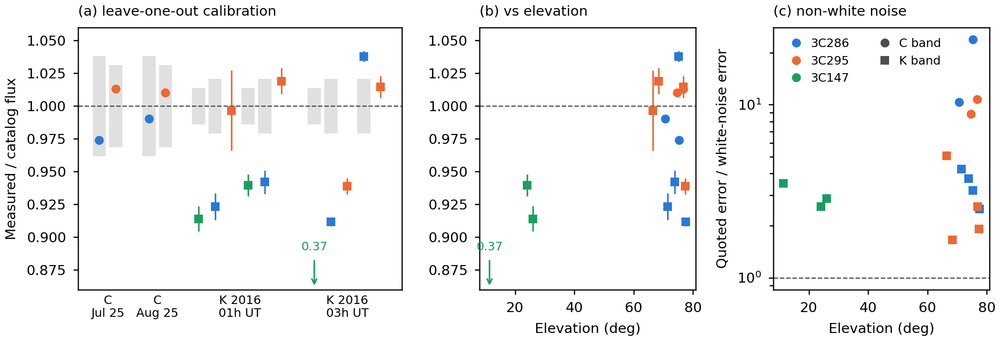

Cross-scan Tutorial: fluxes and upper limits
--------------------------------------------
Cross scans (a few subscans along RA and Dec through the source position,
repeated many times) are the most efficient way to measure the flux of a
point source of known position, or to put an upper limit on it.
``SDTcross`` does this from the same data and configuration files used by
``SDTimage``.

Preparing the data
~~~~~~~~~~~~~~~~~~
Prepare a configuration file listing the source and calibrator directories,
as described in the :doc:`imaging` tutorial, and run ``SDTcal`` on the
calibrators:

.. code-block:: console

    (py3) $ SDTcal -c MySource.ini --splat <freqmin:freqmax> -o calibration.hdf5

Then, either let ``SDTcross`` read the scans directly from the configuration
file:

.. code-block:: console

    (py3) $ SDTcross -c MySource.ini --calibrate calibration.hdf5

or use a ``_dump.hdf5`` file saved by ``SDTimage`` (e.g. after cleaning the
data interactively):

.. code-block:: console

    (py3) $ SDTimage -c MySource.ini
    (py3) $ SDTcross my_products/intermediate/MySource_dump.hdf5 --calibrate calibration.hdf5

(the dump file is in the intermediate product directory, here with
``productdir = my_products`` in the config file).

If the dump file already contains calibrated ``<channel>_cal`` columns,
``--calibrate`` can be omitted; without any calibration, fluxes are in
counts.

What SDTcross does
~~~~~~~~~~~~~~~~~~
For each subscan and channel, a smooth baseline (a cubic spline with knots
a few beams apart) and a Gaussian beam centred at the nominal source
position are fitted together. Position and width of the Gaussian are fixed
(a *forced fit*): only its amplitude is measured, and it can be negative
when there is no source.

The flux is the average of the amplitudes over the subscans (LCP and RCP
are averaged subscan by subscan first). Its error comes from the scatter of
the amplitudes between subscans: it is correct also when the noise is not
white (1/f noise, baseline drifts), which is the usual case. Subscans whose
noise is anomalous (e.g. residual RFI) are ignored, with a warning
(``--rfi-nsigma``).

A source is *detected* if its flux is more than ``--nsigma`` (default 3)
times its error. The upper limit is the measured flux (or zero, if negative)
plus ``--nsigma`` times the error, with the calibration error added in
quadrature.

Outputs
~~~~~~~
For an input ``MySource_dump.hdf5`` (or ``MySource.ini``), ``SDTcross``
writes, in the product directory (``productdir`` of the config file, or
``--productdir``; for dump files of older versions, next to the dump), or
with the root given with ``-o``:

- ``MySource_cross.fits``: the main results as keywords of the primary
  header (``FLUX``, ``FLUXERR``, ``UPLIM``, ``NSIGMA``, ``DETECTED``,
  ``BUNIT``, ``CALERR``, the consistency checks ``CONS_ARM``,
  ``CONS_POL`` and ``CONS_SHP``, ...), and three tables: ``SUMMARY`` (results per channel,
  per arm and in total), ``PROFILES`` (the baseline-subtracted profiles) and
  ``SUBSCANS`` (the amplitude in each subscan and channel);
- ``MySource_cross.ecsv``: the summary table;
- ``MySource_cross.png`` and ``MySource_cross_total.png``: the profiles
  along each arm, for each channel and in total, with the fitted beam.

The summary is also printed:

.. code-block:: console

        label      channel  arm   flux      err    nsub    ul    detected
    ------------- --------- --- -------- --------- ---- -------- --------
     Feed0_LCP RA Feed0_LCP  RA 0.008211 0.0007449  523  0.01045     True
    Feed0_LCP Dec Feed0_LCP Dec 0.007619 0.0006957  527 0.009706     True
        Feed0_LCP Feed0_LCP     0.007914 0.0005093 1050 0.009442     True
     Feed0_RCP RA Feed0_RCP  RA 0.006734 0.0005729  518 0.008453     True
    Feed0_RCP Dec Feed0_RCP Dec 0.006997 0.0005473  525 0.008639     True
        Feed0_RCP Feed0_RCP     0.006867 0.0003959 1043 0.008054     True
               RA            RA  0.00754 0.0004811  528 0.008983     True
              Dec           Dec 0.007338 0.0004644  532 0.008731     True
            TOTAL               0.007439 0.0003341 1060 0.008441     True

Checks
~~~~~~
- The RA and Dec arms, and the two polarizations, should agree within the
  errors (``CONS_ARM`` and ``CONS_POL`` are their differences in standard
  deviations; a warning is printed above ``--nsigma``). A large difference
  between arms can mean a pointing offset or a nearby source.
- ``CONS_SHP`` compares the default fit (baseline and beam fitted
  together) with a fit of the baseline outside a window around the source.
  A large negative value (a warning is printed) means that the source is
  wider than the beam or offset from the nominal position, and its flux is
  probably underestimated. A large positive value means that the beam is
  narrower than assumed (see ``--beam-fwhm``) or that there is structure
  near the source.
- The forced fit measures the peak of a point source at the nominal
  position. A pointing offset, or a source wider than the beam, make the
  flux lower. If the profiles are visibly wider than the fitted beam, or
  their peak is off-centre, the flux is a lower limit to the true one.
- Other sources along the scans, outside the region around the target, can
  bend the baseline and bias the flux (by up to half of their own flux).
  See :doc:`../technical_details` for the method and its validation.
- ``--source-coords`` measures the flux at a different position, e.g. to
  check that the result is zero away from the source.

A real example: flux calibrators
~~~~~~~~~~~~~~~~~~~~~~~~~~~~~~~~
Standard flux calibrators make a good test, because their flux is known.
We measured 15 cross-scan observations of 3C286, 3C295 and 3C147 taken at
SRT: two C-band sessions in 2025 (7 GHz, four crosses per observation) and
one K-band night in 2016 (21 GHz, one cross per observation). Each
observation was calibrated by ``SDTcal`` on the *other* calibrators of the
same session (leave-one-out), measured with ``SDTcross --calibrate``, and
compared with the flux catalog of srttools (Perley & Butler 2013).

(a) Measured flux divided by the catalog flux. Error bars: the error given
by ``SDTcross``; grey bands: the uncertainty of the catalog. (b) The same
against elevation. (c) Error given by ``SDTcross`` divided by the error that
white noise alone would give.

What this shows:

- At C band the measured fluxes agree with the catalog within 1-3%, inside
  the uncertainty of the catalog itself (3-4%). The statistical error of ``SDTcross``
  (0.1-0.3% on these bright sources) is negligible: on bright sources the
  accuracy is set by the calibration, not by the measurement.
- At K band, the gain of the system changed by about 50% during the night,
  probably because of the weather: the humidity dropped from 93% to 66%,
  and 21 GHz is close to an absorption line of water vapour. Calibrated on the whole night, the fluxes were off
  by up to 25%; calibrated on the calibrators observed within the same half
  hour, as in the figure, they agree within 10%. At high frequency, observe
  a calibrator close in time *and* in elevation to the target.
- One K-band observation of 3C147, at 11 degrees of elevation, gives 0.37
  times the catalog flux: the calibrators of that block were all at 75-77
  degrees, and the calibration cannot be extrapolated that far (srttools
  warns about it). Absorption in the atmosphere and the deformation of the
  beam are large at low elevation.
- The errors from the scatter between subscans are 2 to 30 times larger
  than white noise alone would give (panel c). On bright sources the
  scatter is dominated by effects proportional to the flux (small pointing
  errors, gain fluctuations); an error estimated from the white noise alone
  would be far too optimistic.

The consistency checks behave differently on bright sources:

- ``CONS_SHP`` was between +5 and +21 in all these observations. The beam
  fitted by ``SDTcal`` on the same calibrators is narrower than the default
  (1.22 lambda / D): by 1.5% at C band and by 7% at K band. Passing the fitted
  width with ``--beam-fwhm`` increases the fluxes by 0.15% at C band and by
  2% at K band, and brings ``CONS_SHP`` down to 0-5 at K band. At C band it
  stays around 10: at a precision of 0.2%, the small deviations of the real
  beam from a Gaussian (e.g. its first sidelobe) are detected. For bright
  sources, or at high frequency, give ``--beam-fwhm`` from the calibrator
  fits (the ``Width`` column of the ``SDTcal`` table is the standard
  deviation of the Gaussian, in degrees: multiply by 2.355 and by 60 to get
  the FWHM in arcmin).
- ``CONS_ARM`` was -9.5 in one observation of 3C286: the RA scans gave 3%
  less than the Dec scans. This is not a pointing offset: the offsets fitted
  by ``SDTcal`` (at most 0.15', 5% of the beam) cost only a few tenths of a
  percent, and about the same on both arms. The RA profiles are narrower
  than the Dec ones (2.74' against 2.79') and 1.6% lower even in the fits of
  ``SDTcal``, where position and width are free: the beam is slightly
  elongated, and a circular beam model cannot fit both arms at this
  precision. The flux of that observation is 2.4% below the catalog.
- ``CONS_POL`` scattered more than expected (standard deviation 2.2 instead
  of 1). On bright sources, it measures how well each polarization channel
  is calibrated: a 1% difference is 5 standard deviations at a precision
  of 0.2%.

On faint sources, where the noise dominates, these checks are much
closer to the statistics expected from the noise (see
:doc:`../technical_details`).
